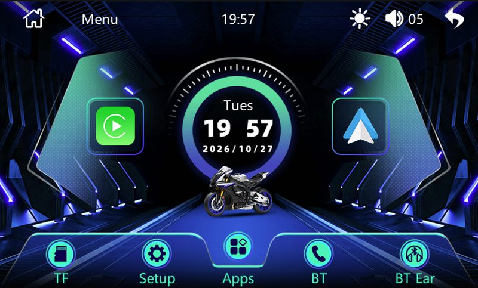

# EKIY / Melis reverse engineering

Run the real home-screen firmware of an EKIY 5-inch wireless CarPlay display on a PC, inspect its UI resources, and experiment with modifications without first flashing the device.



This repository contains a TypeScript application-level emulator, a DATAV1.0 UI reader/writer and skin builder, a version-specific MinFS replacement recipe (including compressed module sections), and format documentation. **No firmware, extracted vendor files, SDK source, or binary tools are included** (the screenshot above is the only vendor imagery). Bring your own dump.

Developed on PCB **SK-8168-MAIN-V6.2**, Allwinner **F133-B / RISC-V C906**, Melis RTOS, EON EN25QH128A 16 MiB SPI NOR, MinFS rootfs. The firmware identifies itself as `SK-8168V6.0-LVWTNFMTX-2405221856`; the V6.0 string is distinct from the physical PCB revision.

The emulator boots the real home UI and supports mouse touch input, display composition, persisted settings, and file overlays. It is an HLE research tool with many stubbed services, not a complete SoC emulator or an implementation of wireless CarPlay/Android Auto. The brightness popup, minimum-brightness patch, and Adventure skin are **emulator-verified, not yet tested on hardware**. A preceding boot-video replacement was separately flashed and verified on the research device.

Use Node.js 22.6 or newer, npm, and Python 3 (Pillow for image-related tools):

```sh
# Obtain dump_tool separately; v0.5.0 was used for this project.
# Use a NEW output directory: extract deletes an existing destination.
dump_tool extract /path/to/your-dump.bin /path/to/new-extracted-dump

cd emu
npm ci
npm run serve -- --dump /path/to/new-extracted-dump --fresh
# Open http://localhost:8133
```

`--dump` selects the extraction output directory **containing `gpt.bin.out/`**, not the rootfs directory. Alternatively set `EKIY_DUMP`. `--fresh` resets emulator state; omit it to retain settings. For a batch run:

```sh
npm run run -- --dump /path/to/new-extracted-dump --stub --steps 1000000000 --png home.png
npm run typecheck
npm test
```

The ALU test requires no firmware. The decoder comparison skips explicitly without a dump; with a dump it requires LLVM objdump (LLVM 19 was used) or an existing disassembly listing. See [emulator usage and architecture](docs/emulator.md).

Python tools run from the repository root after `python3 -m pip install -r requirements.txt`. See [UI format and skin tooling](docs/data-format.md), [MinFS and modules](docs/minfs-and-modules.md), [findings](docs/findings.md), and [modification recipes](docs/mods.md). The image builder accepts only one exact private base image hash; it is not a generic packer.

Credits: [Gamadril/d1s-melis-tools](https://github.com/Gamadril/d1s-melis-tools) provides `dump_tool` extraction/repacking; this project builds on its output, using release [v0.5.0](https://github.com/Gamadril/d1s-melis-tools/releases/tag/v0.5.0). [Vabian124/chipdump](https://github.com/Vabian124/chipdump) documents a related V6.3 board; its layout must not be assumed for V6.2. The [Allwinner d1s-melis SDK mirror](https://gitee.com/grantho/d1s-melis) supplies the API reference: `emu/src/swi-names.ts` is a generated name/number table from `include/melis/ekernel/kapi.h`, not a firmware extract. SDK headers and third-party source are linked rather than bundled.

Project code is MIT-licensed, see [LICENSE](LICENSE). The screenshot shows the vendor's stock UI for identification only. No license to vendor firmware or third-party artwork is granted. Flashing an incorrect image can brick the device; extraction and emulator success do not establish hardware safety. This independent research project is not affiliated with EKIY, Allwinner, Apple, or Google. Trademarks belong to their respective owners.
